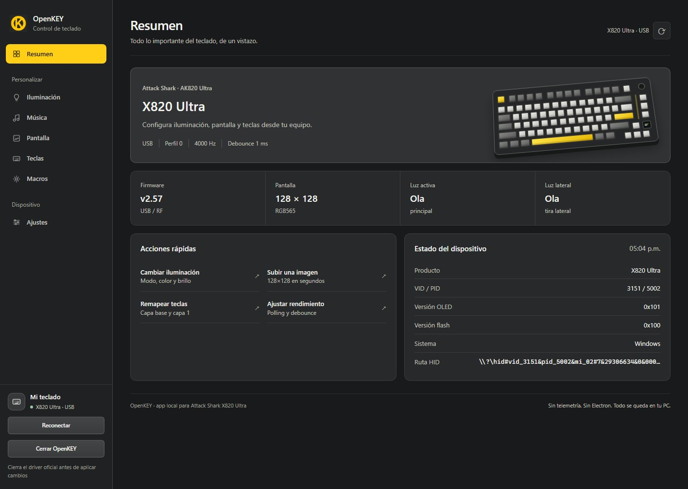
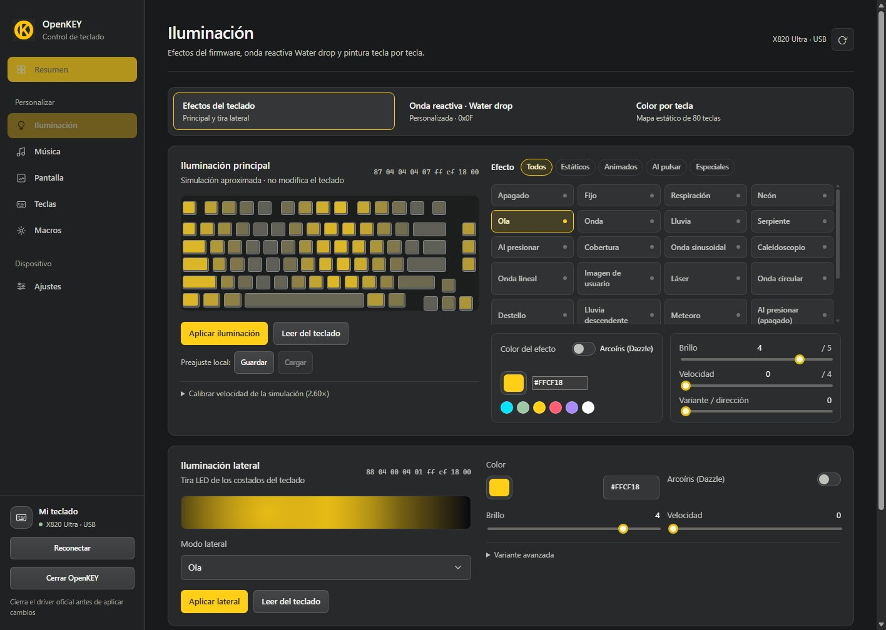
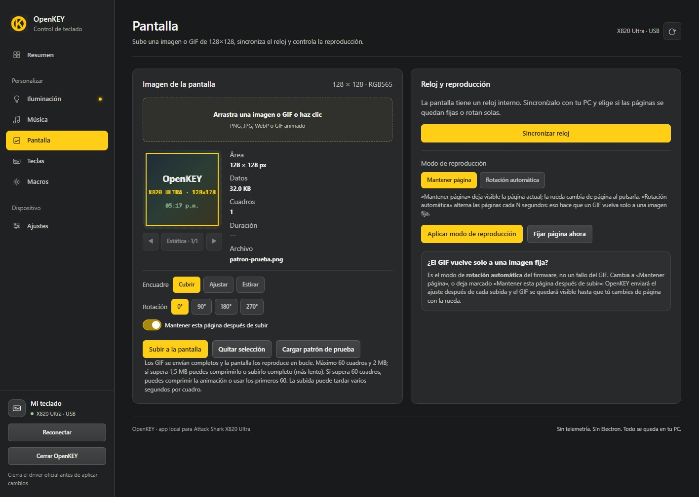
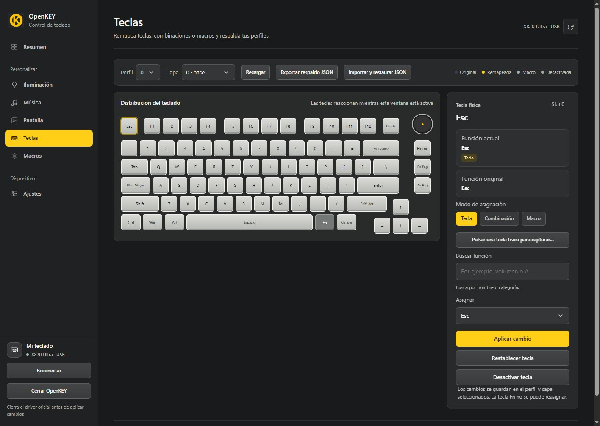
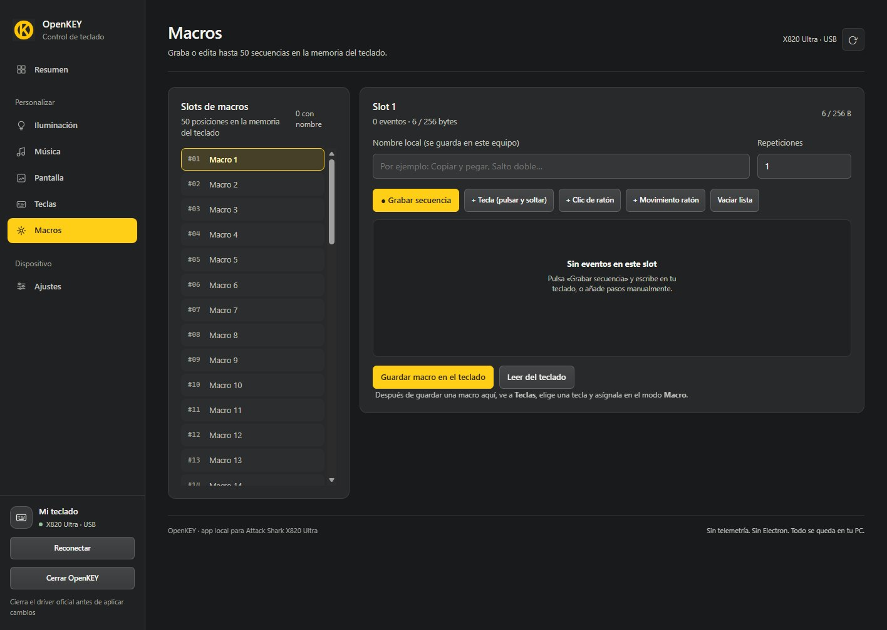
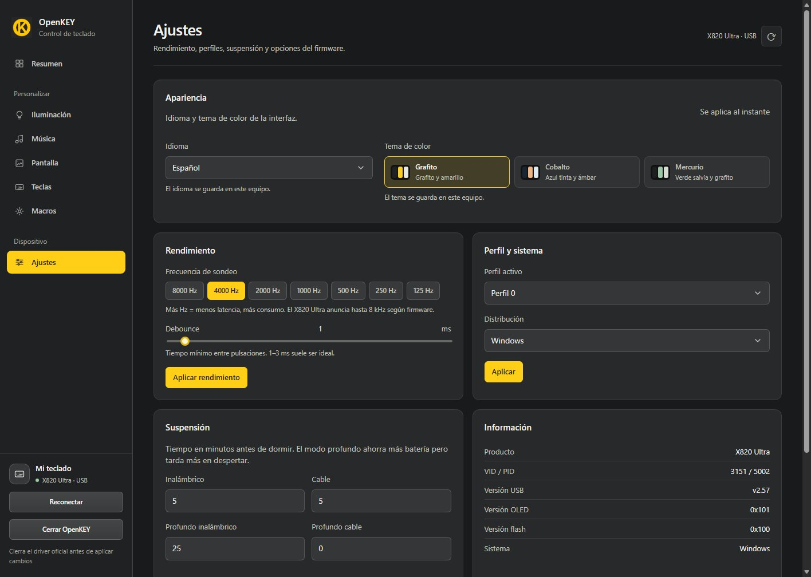
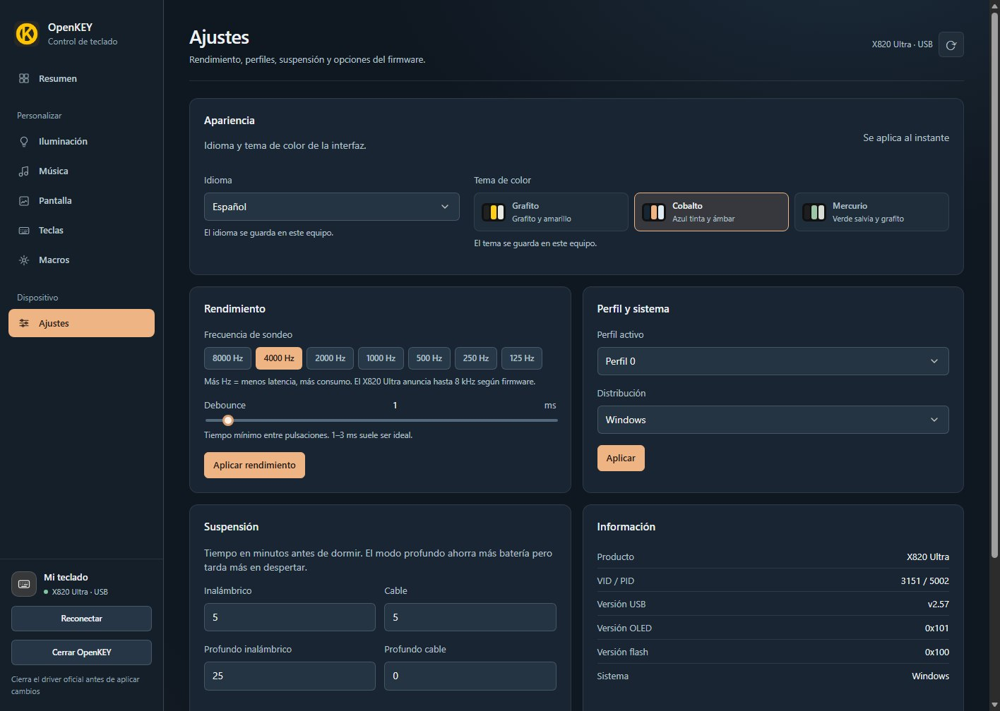
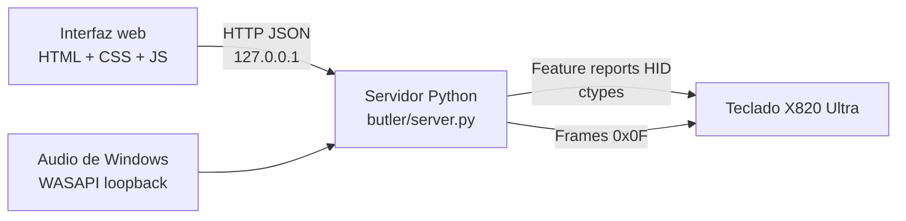

<p align="center">
  
</p>

<h1 align="center">OpenKEY</h1>

<p align="center">
  <strong>Centro de control local para Attack Shark X820 Ultra / AK820 Ultra</strong><br>
  Sin Electron · Sin nube · Sin telemetría · USB HID directo
</p>

<p align="center">
  <a href="README.md">English</a> · <strong>Español</strong>
</p>

<p align="center">
  <a href="https://github.com/kaiizu/openkey/releases/latest"></a>
  
  
  
  
</p>

<p align="center">
  
</p>

OpenKEY es una alternativa local y ligera al controlador oficial del **Attack Shark X820 Ultra** (también vendido como **AK820 Ultra**). Se comunica directamente con el teclado por USB HID y sirve la interfaz desde tu propio PC en `127.0.0.1`: sin cuenta, sin nube, sin telemetría y sin procesos en segundo plano.

> [!TIP]
> Si solo quieres usar la aplicación, descarga la última release, descomprime la carpeta completa y ejecuta `OpenKEY.exe`. No necesitas Python.

## Descarga

<p align="center">
  <a href="https://github.com/kaiizu/openkey/releases/latest"></a>
</p>

- Descarga `OpenKEY-1.2.1-win64.zip` desde [Releases](https://github.com/kaiizu/openkey/releases/latest).
- Descomprime la **carpeta completa**. No muevas `OpenKEY.exe` fuera de `_internal`.
- Ejecuta `OpenKEY.exe`. Windows SmartScreen puede pedir confirmación porque el binario no está firmado.

> [!IMPORTANT]
> OpenKEY **no actualiza el firmware**. Solo configura el teclado mediante los comandos HID que ya existen en el firmware. Si el controlador oficial está abierto, ciérralo antes de aplicar cambios.

## Funciones

| Módulo | Qué hace |
| --- | --- |
| **Resumen** | Modelo, firmware, perfil activo, frecuencia de sondeo, debounce, luz principal/lateral y ruta HID. |
| **Iluminación** | Todos los efectos del firmware, brillo, velocidad, color, *dazzle* y variante para la luz principal y la tira lateral. |
| **Onda reactiva** | Efecto «Water drop» renderizado en el PC y enviado por `0x0F`, sin escribir en flash. Incluye preset y disparo manual/global. |
| **Color por tecla** | Editor sobre el layout real de 80 teclas, con lectura previa, validación y activación de `LightUserPicture`. |
| **Pantalla** | Imágenes y GIF de 128×128, encuadre/rotación, 60 cuadros, rectángulo común, reloj y modo de reproducción de páginas. |
| **Teclas** | Remapeo de tecla, combinación o macro por perfil/capa, captura de tecla física y protección de Fn. |
| **Macros** | 50 slots de 256 bytes, grabación, edición de eventos y escritura verificada con `0x0B`. |
| **Respaldos** | Exportación/importación JSON de perfiles y capas, con restauración completa y verificada. |
| **Música** | Sincronización con la salida de Windows por WASAPI loopback, FFT propia y frames RGB de 21×6. |
| **Apariencia** | Interfaz **Español/English** y temas **Grafito**, **Cobalto** y **Mercurio**. |

## Capturas

| Iluminación | Onda reactiva |
| :---: | :---: |
|  |  |

| Pantalla | Teclas |
| :---: | :---: |
|  |  |

| Macros | Ajustes |
| :---: | :---: |
|  |  |

<p align="center">
  
  <br>
  <sub>Español + tema Cobalto · el idioma y el tema se eligen en Ajustes → Apariencia.</sub>
</p>

## Cómo funciona



- **Backend:** Python + `ctypes` sobre `hid.dll` / `setupapi.dll`. Sin Node, Electron ni WebHID.
- **Frontend:** HTML, CSS y JavaScript sin framework, servido localmente.
- **HID:** *feature reports* de 64 bytes. Los comandos y paquetes están documentados en [`docs/PROTOCOL.md`](docs/PROTOCOL.md).
- **Sin dependencias de ejecución:** todo funciona con la biblioteca estándar de Python y los archivos de `web/`.

### Dispositivo

| Campo | Valor |
| --- | --- |
| Modelo | Attack Shark X820 Ultra / AK820 Ultra |
| VID / PID (cable) | `0x3151` / `0x5002` |
| Device ID | `3461` (`0x0D85`) |
| Pantalla | 128 × 128, RGB565 |
| Firmware de referencia | Attack Shark Driver v4 3.2.20 |

## Instalación desde el código

Requisitos: **Windows 10/11**, Python **3.10+** (probado con 3.15) y el teclado conectado por USB.

```powershell
git clone https://github.com/kaiizu/openkey.git
cd openkey
python run.py
```

También puedes usar los lanzadores incluidos:

```text
OpenKEY.bat                 # con consola
OpenKEY (sin consola).vbs   # en segundo plano
```

La interfaz está disponible en `http://127.0.0.1:8737/`. Si el puerto está ocupado, la siguiente instancia usa el siguiente puerto libre.

### Compilar el `.exe`

```powershell
.\tools\build_exe.ps1
```

El script crea un entorno local `.venv-build`, instala PyInstaller desde `requirements-dev.txt` y genera `dist\OpenKEY\OpenKEY.exe` en modo *onedir*, sin consola. Cierra OpenKEY antes de recompilar.

## Uso rápido

<details>
<summary><strong>Iluminación y onda reactiva</strong></summary>

La pestaña se divide en **Efectos del teclado**, **Onda reactiva · Water drop** y **Color por tecla**.

- **Efectos:** elige una categoría, ajusta color/brillo/velocidad y pulsa **Aplicar iluminación**. La tira lateral tiene su propia tarjeta.
- **Water drop:** anillos suaves desde cada tecla, renderizados en el PC y enviados a 15/20/30 fps. Usa `GetAsyncKeyState`, no un hook global. Al detener se restaura la iluminación anterior.
- **Onda del firmware:** guarda el modo Onda nativo para usarlo con la aplicación cerrada.
- **Color por tecla:** lee el mapa actual, permite pintar sobre el layout y verifica la lectura posterior antes de activar el modo personalizado.

</details>

<details>
<summary><strong>Pantalla y GIF</strong></summary>

Arrastra una imagen o GIF. OpenKEY la ajusta a 128×128, la convierte a RGB565 y envía solamente el rectángulo con píxeles no negros.

- **Hasta 60 cuadros y 2 MB.**
- Los GIF de más de 1,5 MB se pueden comprimir o subir completos.
- Los GIF de más de 60 cuadros se pueden comprimir (muestreo uniforme) o recortar a los primeros 60.
- La opción **Mantener esta página después de subir** fija la página con `0x2F` para que el GIF no vuelva a una imagen anterior.

</details>

<details>
<summary><strong>Teclas, macros y respaldos</strong></summary>

- Elige un perfil y una capa, selecciona una tecla y asigna tecla, combinación o macro.
- **Fn** está protegida para no romper la capa de funciones.
- Los respaldos JSON incluyen los perfiles 0/1 y las capas base/Fn; la restauración escribe y verifica.
- Las macros tienen 50 slots de 256 bytes y se guardan con `0x0B`; después se asignan desde **Teclas → Macro**.

</details>

<details>
<summary><strong>Música y apariencia</strong></summary>

- **Música** captura la salida predeterminada de Windows por WASAPI loopback, calcula una FFT de 1024 muestras y envía frames de 21×6 por `0x0F`. Solo se ejecuta mientras está activa.
- **Apariencia** permite cambiar entre **Español/English** y los temas **Grafito**, **Cobalto** y **Mercurio**. Las preferencias se guardan en `localStorage`.
- Para previsualizar sin cambiar tus preferencias: `?lang=en` o `?theme=cobalto`.

</details>

## Estado y limitaciones

- Probado contra el teclado físico por USB.
- El receptor **2.4G** y **Bluetooth** todavía no están soportados.
- La música usa solo la **salida predeterminada** de Windows.
- No hay actualización de firmware ni recuperación por USB.
- La tecla **Fn** tiene un LED rojo de carga que no es RGB y no se controla por software.
- El ejecutable no está firmado; SmartScreen puede pedir confirmación.

> [!WARNING]
> No instales firmware de otros teclados, incluido el AJAZZ AK820 Pro: usa otra MCU, otro bootloader y otro formato de actualización. OpenKEY no modifica el firmware.

## Desarrollo

```powershell
# Comprobaciones rápidas
python -m compileall -q butler run.py tools
node --check web\app.js
node --check web\i18n.js
python -m unittest discover -s tests -v

# Servidor de desarrollo
python run.py --no-browser

# Ejecutable
.\tools\build_exe.ps1
```

### i18n y temas

- **Idioma:** el español es el idioma de origen. Las traducciones inglesas están en `web/i18n.js`; un `MutationObserver` traduce también los textos generados dinámicamente.
- **Temas:** la base está en `web/cobalto.css`; `web/themes.css` contiene Cobalto y Mercurio, además del selector de Apariencia.
- **Datos generados:** no edites `web/layout_ak820.json`, `web/keycodes.json` ni `data/*.json` a mano; regenéralos con `tools/`.

### Estructura del repositorio

```text
butler/                 backend Python
  core.py               protocolo YC3123, luces, pantalla, matriz y macros
  audio.py              WASAPI loopback, FFT y frames 0x0F
  ripple.py             onda reactiva Water drop
  hidwin.py             HID con ctypes
  server.py             servidor HTTP local y API JSON
web/                    interfaz
  index.html
  style.css
  cobalto.css
  themes.css            Grafito, Cobalto y Mercurio
  app.js
  i18n.js               Español → English
  logo.png / logo.ico
data/                   datos extraídos del controlador oficial
docs/                   protocolo, capturas y prototipos
tests/                  tests con HID simulado
tools/                  extracción, sondeo y build
dist/OpenKEY/           ejecutable empaquetado (no versionado)
```

El protocolo completo, los checksums y la referencia de comandos están en [`docs/PROTOCOL.md`](docs/PROTOCOL.md).

## Seguridad

- Todo se ejecuta en `127.0.0.1`; no se envía nada a Internet.
- OpenKEY no instala controladores ni modifica el registro.
- Las escrituras HID no se repiten automáticamente después de un fallo de comunicación: reconecta y lee el estado antes de volver a intentarlo.
- El controlador oficial y OpenKEY comparten los mismos *feature reports*; cierra el controlador oficial antes de aplicar cambios.

## Licencia

MIT. Ver [`LICENSE`](LICENSE).

## Créditos

Proyecto personal, no oficial. «Attack Shark», «X820 Ultra» y «AK820 Ultra» son marcas de sus respectivos propietarios. El protocolo se obtuvo analizando la aplicación oficial instalada y verificando las respuestas del teclado; no se distribuye código propietario del controlador. La inspiración para la vista previa y el preajuste local viene de [OpenKeyboard](https://openkeyboard.abhicracker.com/), que usa protocolos distintos.

Usa OpenKEY bajo tu propio riesgo y guarda una copia de tu configuración.
