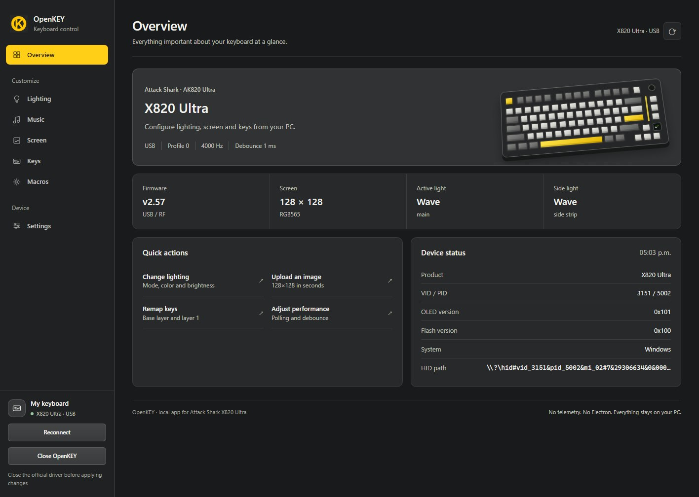
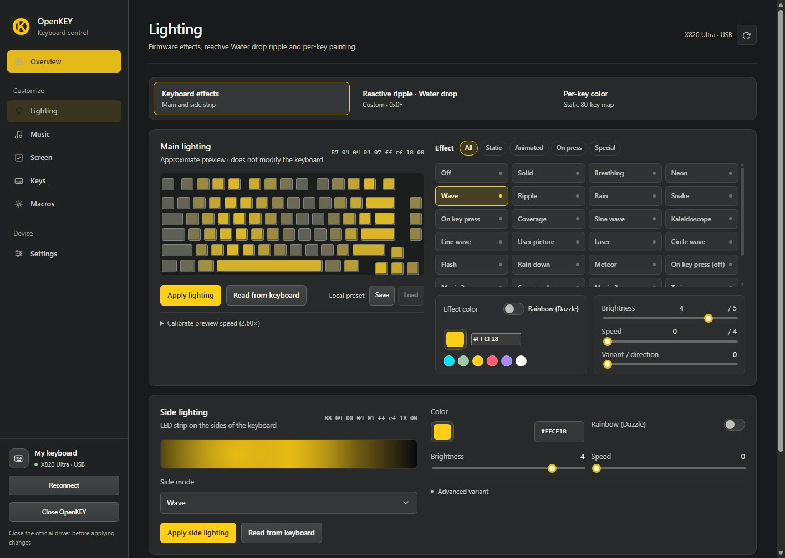
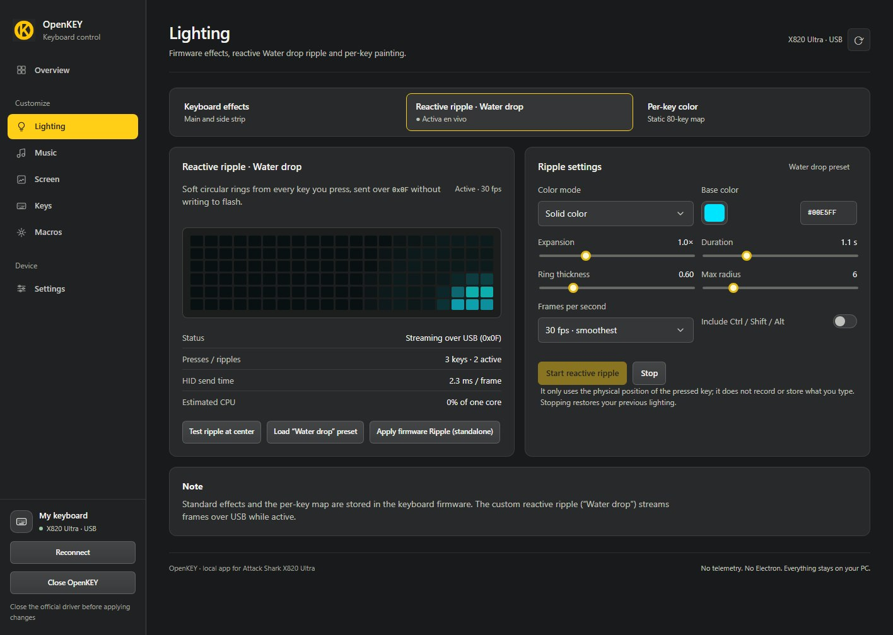
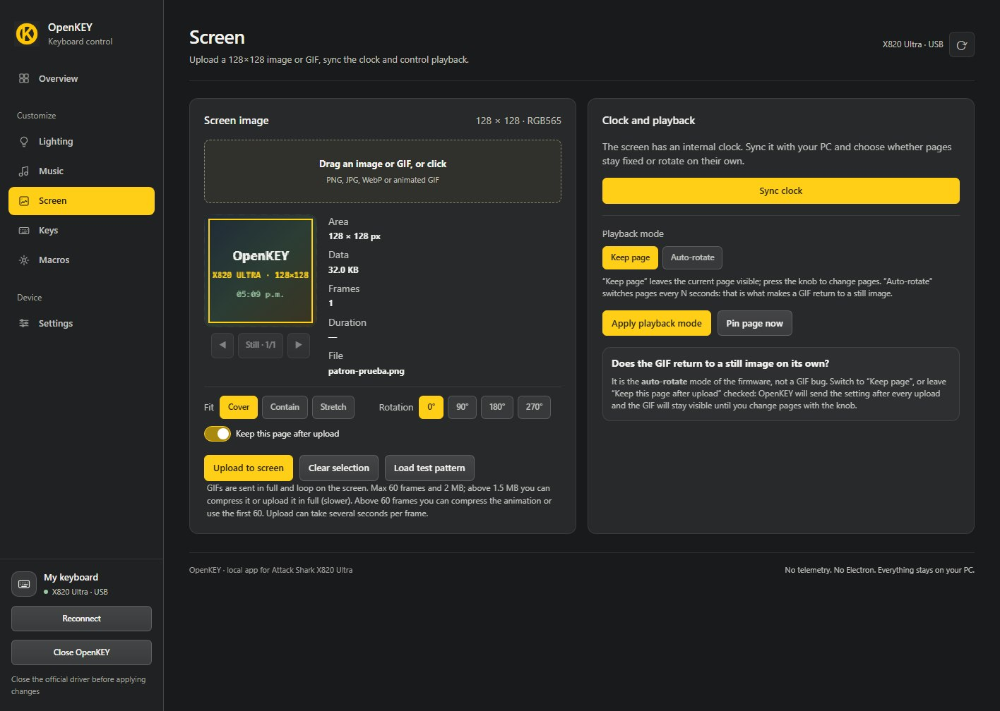
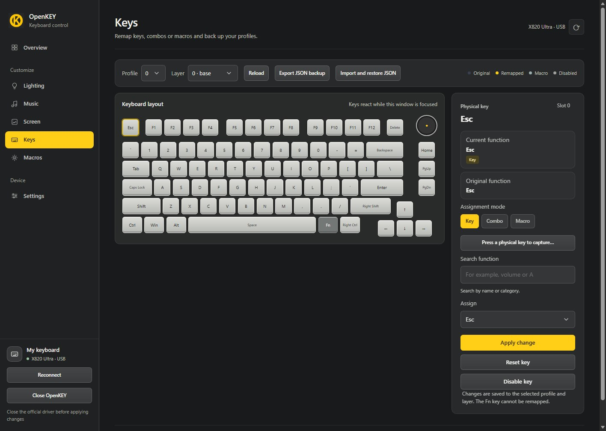
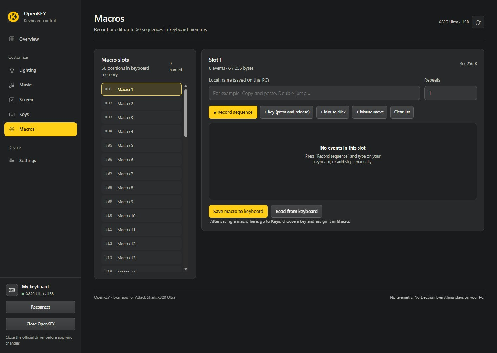
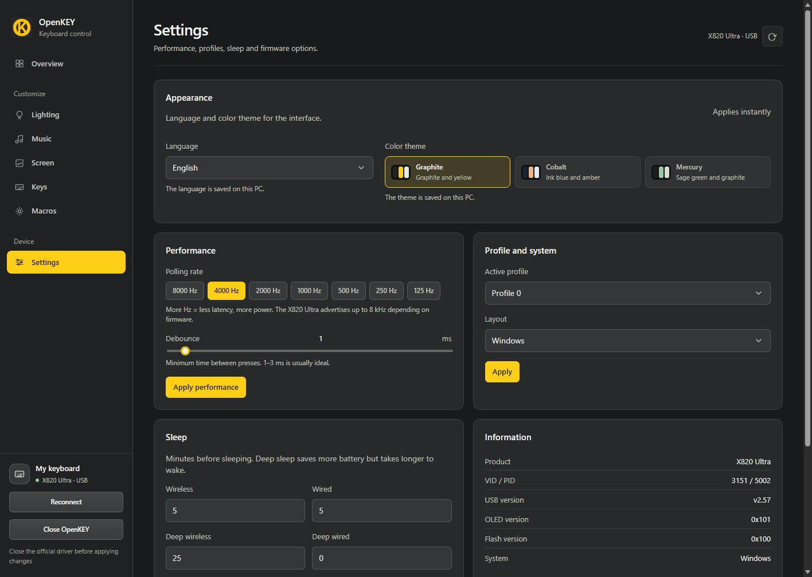
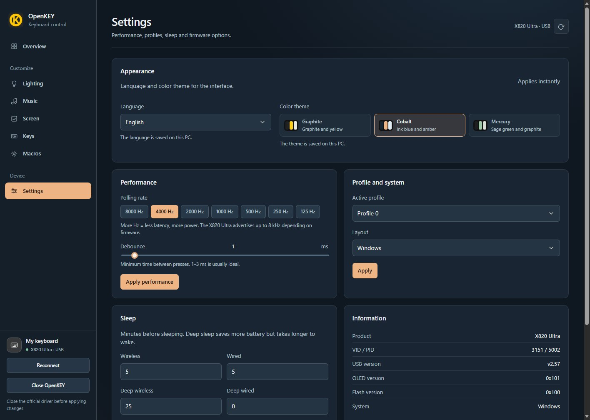
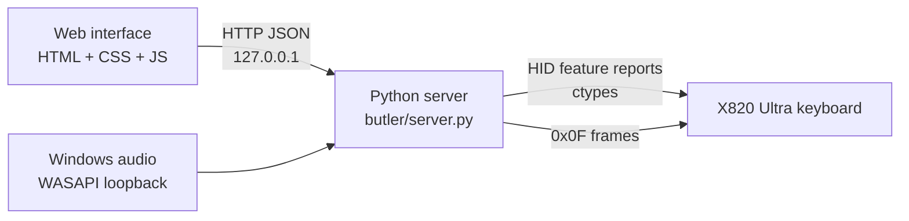

<p align="center">
  
</p>

<h1 align="center">OpenKEY</h1>

<p align="center">
  <strong>A local control center for the Attack Shark X820 Ultra / AK820 Ultra</strong><br>
  No Electron · No cloud · No telemetry · Direct USB HID
</p>

<p align="center">
  <a href="README.es.md">Español</a> · <strong>English</strong>
</p>

<p align="center">
  <a href="https://github.com/kaiizu/openkey/releases/latest"></a>
  
  
  
  
</p>

<p align="center">
  
</p>

OpenKEY is a lightweight, local alternative to the official driver for the **Attack Shark X820 Ultra** (also sold as the **AK820 Ultra**). It talks to the keyboard directly over USB HID and serves the interface from your own PC at `127.0.0.1`: no account, no cloud service, no telemetry and no background workers.

> [!TIP]
> If you only want to use the app, download the latest release, extract the folder and run `OpenKEY.exe`. Python is not required.

## Download

<p align="center">
  <a href="https://github.com/kaiizu/openkey/releases/latest"></a>
</p>

- Download `OpenKEY-1.2.1-win64.zip` from [Releases](https://github.com/kaiizu/openkey/releases/latest).
- Extract the **whole folder**. Do not move `OpenKEY.exe` away from `_internal`.
- Run `OpenKEY.exe`. Windows SmartScreen may ask for confirmation because the binary is not signed.

> [!IMPORTANT]
> OpenKEY **does not update the firmware**. It only configures the keyboard through the HID commands already present in the firmware. If the official driver is open, close it before applying changes.

## Features

| Module | What it does |
| --- | --- |
| **Overview** | Model, firmware, active profile, polling rate, debounce, main/side lighting and HID path. |
| **Lighting** | All firmware effects, brightness, speed, color, *dazzle* and variant for the main light and side strip. |
| **Reactive ripple** | PC-rendered “Water drop” effect sent over `0x0F`, with no flash writes. Includes a preset and manual/global triggering. |
| **Per-key color** | Editor over the real 80-key layout, with read-before-write validation and `LightUserPicture` activation. |
| **Screen** | 128×128 images and GIFs, fit/rotation, 60 frames, shared bounding box, clock and page playback mode. |
| **Keys** | Remap a key, combo or macro per profile/layer, capture a physical key and protect the Fn key. |
| **Macros** | 50 slots of 256 bytes, recording, event editing and verified writes with `0x0B`. |
| **Backups** | JSON export/import of profiles and layers, with a verified full restore. |
| **Music** | Windows output sync through WASAPI loopback, a built-in FFT and 21×6 RGB frames. |
| **Appearance** | **Español/English** interface and **Graphite**, **Cobalt** and **Mercury** themes. |

## Screenshots

| Lighting | Reactive ripple |
| :---: | :---: |
|  |  |

| Screen | Keys |
| :---: | :---: |
|  |  |

| Macros | Settings |
| :---: | :---: |
|  |  |

<p align="center">
  
  <br>
  <sub>English + Cobalt theme · choose the interface language and theme in Settings → Appearance.</sub>
</p>

## How it works



- **Backend:** Python + `ctypes` over `hid.dll` / `setupapi.dll`. No Node, Electron or WebHID.
- **Frontend:** plain HTML, CSS and JavaScript served locally.
- **HID:** 64-byte feature reports. Commands and packet layouts are documented in [`docs/PROTOCOL.md`](docs/PROTOCOL.md).
- **No runtime dependencies:** everything runs on the Python standard library and the files in `web/`.

### Device

| Field | Value |
| --- | --- |
| Model | Attack Shark X820 Ultra / AK820 Ultra |
| VID / PID (wired) | `0x3151` / `0x5002` |
| Device ID | `3461` (`0x0D85`) |
| Screen | 128 × 128, RGB565 |
| Reference firmware | Attack Shark Driver v4 3.2.20 |

## Install from source

Requirements: **Windows 10/11**, Python **3.10+** (tested with 3.15) and the keyboard connected over USB.

```powershell
git clone https://github.com/kaiizu/openkey.git
cd openkey
python run.py
```

You can also use the included launchers:

```text
OpenKEY.bat                 # with console
OpenKEY (sin consola).vbs   # background
```

The UI is available at `http://127.0.0.1:8737/`. If the port is busy, the next instance uses the next free port.

### Build the `.exe`

```powershell
.\tools\build_exe.ps1
```

The script creates a local `.venv-build`, installs PyInstaller from `requirements-dev.txt` and produces `dist\OpenKEY\OpenKEY.exe` as an *onedir* build without a console. Close OpenKEY before rebuilding.

## Quick usage

<details>
<summary><strong>Lighting and reactive ripple</strong></summary>

The tab is split into **Keyboard effects**, **Reactive ripple · Water drop** and **Per-key color**.

- **Effects:** choose a category, adjust color/brightness/speed and press **Apply lighting**. The side strip has its own card.
- **Water drop:** smooth rings from every key, rendered on the PC and sent at 15/20/30 fps. It uses `GetAsyncKeyState`, not a global hook. Stopping restores your previous lighting.
- **Firmware ripple:** stores the native Ripple mode for use with the app closed.
- **Per-key color:** reads the current map, lets you paint over the layout and verifies the read-back before enabling custom mode.

</details>

<details>
<summary><strong>Screen and GIFs</strong></summary>

Drag an image or GIF. OpenKEY scales it to 128×128, converts it to RGB565 and sends only the rectangle containing non-black pixels.

- **Up to 60 frames and 2 MB.**
- GIFs over 1.5 MB can be compressed or uploaded in full.
- GIFs over 60 frames can be compressed (uniform sampling) or trimmed to the first 60.
- **Keep this page after upload** pins the page with `0x2F`, so the GIF does not jump back to an older image.

</details>

<details>
<summary><strong>Keys, macros and backups</strong></summary>

- Choose a profile and layer, select a key and assign a key, combo or macro.
- **Fn** is protected so the function layer keeps working.
- JSON backups include profiles 0/1 and base/Fn layers; restore writes and verifies them.
- Macros have 50 slots of 256 bytes and are stored with `0x0B`; assign them from **Keys → Macro**.

</details>

<details>
<summary><strong>Music and appearance</strong></summary>

- **Music** captures the Windows default output through WASAPI loopback, computes a 1024-sample FFT and sends 21×6 frames over `0x0F`. It only runs while active.
- **Appearance** switches between **Español/English** and the **Graphite**, **Cobalt** and **Mercury** themes. Preferences are stored in `localStorage`.
- Preview a variant without changing your saved preferences with `?lang=en` or `?theme=cobalt`.

</details>

## Status and limitations

- Tested against the physical keyboard over USB.
- The **2.4G receiver** and **Bluetooth** are not supported yet.
- Music uses only the **Windows default output**.
- No firmware update or USB recovery path is implemented.
- The **Fn** key has a fixed red charging LED; it is not RGB and cannot be controlled by software.
- The executable is unsigned; SmartScreen may ask for confirmation.

> [!WARNING]
> Do not flash firmware from other keyboards, including the AJAZZ AK820 Pro: it uses a different MCU, bootloader and update format. OpenKEY does not modify firmware.

## Development

```powershell
# Quick checks
python -m compileall -q butler run.py tools
node --check web\app.js
node --check web\i18n.js
python -m unittest discover -s tests -v

# Development server
python run.py --no-browser

# Executable
.\tools\build_exe.ps1
```

### i18n and themes

- **Language:** Spanish is the source language. English translations live in `web/i18n.js`; a `MutationObserver` also translates dynamically generated text.
- **Themes:** the base is in `web/cobalto.css`; `web/themes.css` contains Cobalt and Mercury, plus the Appearance picker.
- **Generated data:** do not edit `web/layout_ak820.json`, `web/keycodes.json` or `data/*.json` by hand; regenerate them with `tools/`.

### Repository layout

```text
butler/                 Python backend
  core.py               YC3123 protocol, lights, screen, matrix and macros
  audio.py              WASAPI loopback, FFT and 0x0F frames
  ripple.py             Water drop reactive ripple
  hidwin.py             HID through ctypes
  server.py             local HTTP server and JSON API
web/                    interface
  index.html
  style.css
  cobalto.css
  themes.css            Graphite, Cobalt and Mercury
  app.js
  i18n.js               Spanish → English
  logo.png / logo.ico
data/                   data extracted from the official driver
docs/                   protocol, screenshots and prototypes
tests/                  HID-mocked tests
tools/                  extraction, probing and build scripts
dist/OpenKEY/           packaged executable (not versioned)
```

The full protocol, checksums and command reference are in [`docs/PROTOCOL.md`](docs/PROTOCOL.md).

## Security

- Everything runs on `127.0.0.1`; nothing is sent to the Internet.
- OpenKEY does not install drivers or modify the registry.
- HID writes are not automatically retried after a communication failure: reconnect and read the state before trying again.
- The official driver and OpenKEY share the same feature reports; close the official driver before applying changes.

## License

MIT. See [`LICENSE`](LICENSE).

## Credits

Unofficial personal project. «Attack Shark», «X820 Ultra» and «AK820 Ultra» are trademarks of their respective owners. The protocol was obtained by statically analyzing the installed official app and verifying the keyboard responses; no proprietary driver code is distributed. The preview and local preset were inspired by [OpenKeyboard](https://openkeyboard.abhicracker.com/), which uses different protocols.

Use OpenKEY at your own risk and keep a backup of your configuration.
